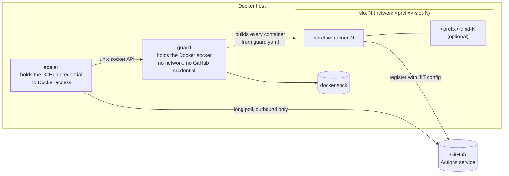
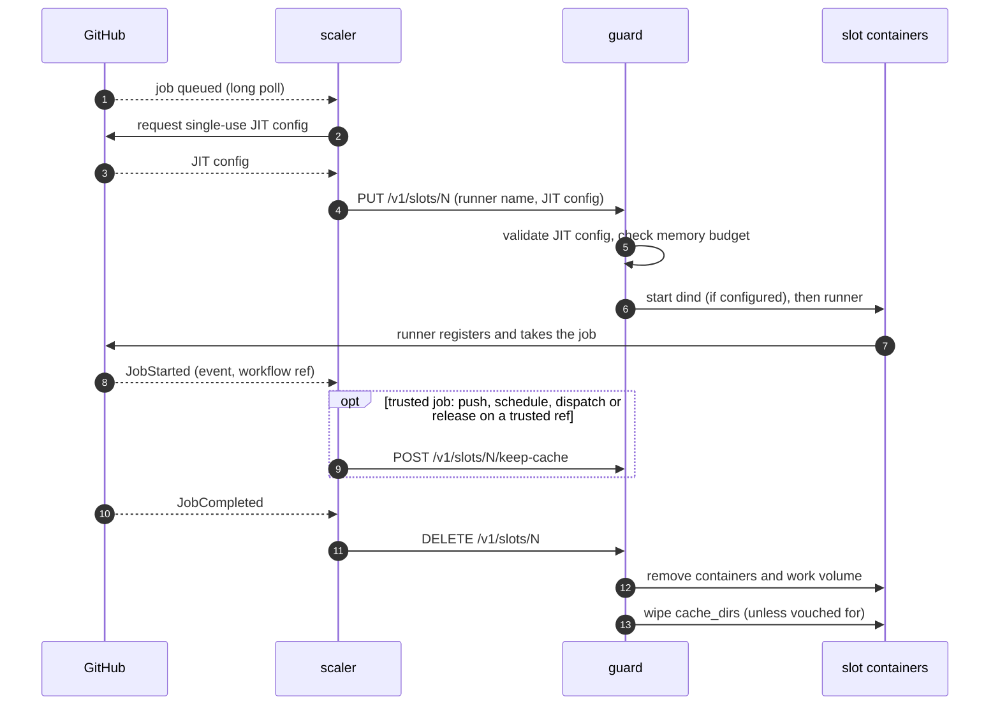
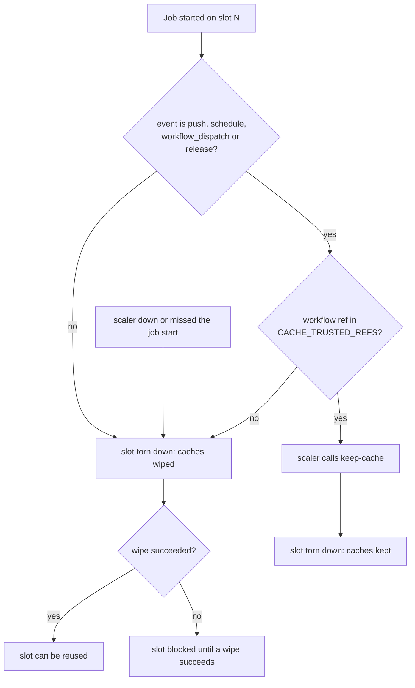

# runner-scaling

Ephemeral, autoscaled GitHub Actions runners on a single Docker host. There's no Kubernetes, and the part that
talks to the internet doesn't hold the Docker socket.

Each queued job gets a fresh runner (and, optionally, its own private Docker daemon), which takes that one job and
is thrown away. Nothing runs while nothing is queued. The scaler is built on GitHub's
[`actions/scaleset`](https://github.com/actions/scaleset) client, the same runner scale set API that
Actions Runner Controller uses. It long-polls GitHub (outbound only), so there's no webhook endpoint to expose.

> Status: early (0.x). The scale set API and the `actions/scaleset` module are in public preview.

## How it works



The software has two parts, both in one small image (`runner-scaling guard` / `runner-scaling scaler`):

- **The scaler** registers a runner scale set, receives job messages, and asks GitHub for a single-use
  just-in-time (JIT) runner config whenever it needs a runner. It hands that config to the guard. It never
  touches Docker.
- **The guard** owns the Docker socket and exposes five calls to the scaler, on a unix socket:

  | Call | What it does |
  |---|---|
  | `GET /v1/info` | prefix, slot count, work dir, GitHub URL |
  | `GET /v1/slots` | which slots exist and their state |
  | `PUT /v1/slots/{n}` | `{runner_name, jit_config}`: start slot *n* |
  | `DELETE /v1/slots/{n}` | stop slot *n* |
  | `POST /v1/slots/{n}/keep-cache` | `{runner_name}`: the job on slot *n* is trusted, so keep its caches (see [Caches](#caches)) |

  Image, mounts, capabilities, limits, networks, `privileged`: every detail of the containers comes from
  `guard.yaml`, a file the scaler can't change. The guard has no network. It also reaps slots whose runner has
  exited, so slots never leak even if the scaler dies.

### Life of a job



## Threat model

The question this design answers: **what does someone who takes over the scaler get?** The scaler is the part
exposed to the internet: it parses GitHub's messages and holds the GitHub credential.

They can:
- start up to `max_slots` runners built exactly from your templates, and stop them;
- register runners in your scale set (they hold your GitHub credential, which this tool can't protect).

They can't:
- create containers of their own design, mount host paths, pick images or turn on `privileged`. The API
  has no way to express any of that;
- point a runner at a server of their own, or at a GitHub org of their own. The guard checks every JIT config
  (see below);
- reach the Docker API in any other way. Every request outside the five calls above is refused and logged as `DENY`.

**What the guard checks in a JIT config.** A JIT config isn't signed, and a runner trusts whatever servers it
names. The guard decodes it and requires that:
- `.runner`'s `ServerUrl` sits under your org's pinned **tenant URL**
  (`https://pipelines….actions.githubusercontent.com/<tenant>/`);
- every URL anywhere in the config is https and either under that tenant or on a shared host (the Actions broker,
  which only accepts runners holding a token your tenant issued);
- `AgentName` is the runner name requested for that slot, and `WorkFolder` is the guard's work dir;
- the config stays under 64 KiB.

**Not solved by this tool. Know these before you use it:**
- **The guard itself is root-equivalent**, because it holds the Docker socket. It is kept small: no network, no
  credentials, a fixed five-call API, read-only filesystem, all capabilities dropped.
- **With the dind sidecar, any job is root on the host.** The sidecar is privileged, so a job can start a
  `--privileged` container against it and mount the host's disk. The guard's API limits what a taken-over *scaler*
  can ask for; it does not limit what a *job* can do. Anyone who can get a workflow onto a repo that uses these
  runners (a push to any branch, a bot such as Dependabot, a stolen token) can run code as root on the host, and so
  can anyone who holds the scaler's GitHub credential (they can create a repo and a workflow of their own). That is
  the cost of letting jobs run `docker build`. Drop the `dind:` section if your jobs don't need Docker, and use a
  Docker-less pool for everything else.
- **Only run jobs from repos you trust.** On GitHub, limit the runner group to private repos, disable fork PR
  workflows (or require approval), keep bot PRs off the Docker pool, and fence the per-slot subnets with a host
  firewall so jobs reach only the internet. On plans without branch protection, any branch can change a workflow.
- **Caches carry over between jobs, unless you list them in `cache_dirs`.** Runners are thrown away, but per-slot
  cache directories (`binds`, including a dind `/var/lib/docker`) are not. A job that can write to them can plant
  code (a toolchain binary, a retagged image) that the next job on that slot runs, whatever repo it comes from.
  Directories listed in `cache_dirs` are emptied by the guard after every job except one the scaler vouches for
  (a push, schedule, dispatch or release on a trusted ref, `refs/heads/main` by default), so a PR or branch job can't
  leave anything behind for a `main` build. Jobs from different repos on `main` still share caches, and a reusable
  workflow's ref is the called workflow's, not the caller's. Unlisted cache binds are not protected.
- **Without dind, jobs are still root in their container** unless the runner image says otherwise, and containers
  share the host kernel: a kernel escape is root on the host. Add a stronger runtime (gVisor, Sysbox, user
  namespaces) if the jobs aren't fully trusted.
- **Jobs can read their runner's credentials.** A job runs as the same user as its runner, so it can read the
  runner's session credentials. This is true of every self-hosted runner. The JIT config is kept out of the job
  environment, but it is on the runner process's command line.
- **The tenant URL is pinned on first use.** Leave `tenant_url` empty on first start. The guard refuses the first
  config and logs the URL it named. Pin that URL only if you are sure the scaler that sent it is yours and talks to
  your org. Check this before anything untrusted could reach the scaler, so on a fresh setup.

## Setup

1. **Credentials for the scaler.** A GitHub App (recommended: `GITHUB_APP_CLIENT_ID`, `GITHUB_APP_INSTALLATION_ID`,
   `GITHUB_APP_PRIVATE_KEY` or `GITHUB_APP_PRIVATE_KEY_FILE`) with organization *Self-hosted runners: read and
   write*, or a classic PAT with `admin:org` (`GITHUB_TOKEN` or `GITHUB_TOKEN_FILE`). For a repo-level scale set, use
   repo *Administration: read and write*.
   To make the App: Organization settings > Developer settings > GitHub Apps > New GitHub App. Untick Webhook, grant
   only Organization permission *Self-hosted runners: Read and write*, and choose "Only on this account". Then
   *Generate a private key* (a `.pem`), and *Install App* on the organization. The Client ID is on the App's page; the
   installation ID is the number at the end of the installation's settings URL
   (`.../settings/installations/<id>`). The App can only manage runners: unlike the PAT it can't touch repos or
   members, and its tokens expire after an hour.
2. **`guard.yaml`.** Start from [examples/guard.yaml](examples/guard.yaml). Pin image digests.
3. **Compose.** See [examples/compose.yaml](examples/compose.yaml). Start it and watch the guard:
   `docker compose logs -f guard`.
4. **Pin the tenant.** The first runner request is refused with
   `DENY ... no tenant_url pinned: this config's ServerUrl is "https://…/<tenant>/"`. Check it, put it in
   `tenant_url`, and restart the guard.
5. **Fence the slot networks (recommended).** Give `subnet` a fixed range and add host firewall rules, in Docker's
   `DOCKER-USER` chain, so jobs reach the internet but not your LAN or the host. Set `require_file` to a file your
   firewall script creates (on a tmpfs), and the guard won't start a slot until the rules are in place.
6. **Target it from workflows** with the scale set's labels, for example `runs-on: [self-hosted, ci]`.

### Scaler flags (or environment)

| Flag | Env | Default | |
|---|---|---|---|
| `--name` | `SCALE_SET_NAME` | guard prefix | scale set name |
| `--labels` | `SCALE_SET_LABELS` | the name | comma-separated labels workflows target |
| `--runner-group` | `RUNNER_GROUP` | `default` | runner group |
| `--min-runners` | `MIN_RUNNERS` | 0 | runners kept warm |
| `--max-runners` | `MAX_RUNNERS` | guard `max_slots` | can't exceed `max_slots` |
| `--delete-scale-set` | | | delete the scale set and exit |
| `--socket` | `GUARD_SOCKET` | `/run/runner-scaling/guard.sock` | guard API socket |
| | `CACHE_TRUSTED_REFS` | `refs/heads/main` | refs whose push/schedule/dispatch/release jobs keep their caches; `none` wipes always |
| | `LOG_LEVEL` | `info` | `debug`, `info`, `warn` or `error` |

### Operations

- **Logs.** `docker logs <guard> 2>&1 | grep DENY` shows every refusal. When the guard refuses a JIT config, it
  also logs the config's shape: keys and URL hosts only, never values.
- **Restarts.** Restarting the scaler or guard doesn't kill running jobs. The scale set stays registered, and
  queued jobs wait for it. If the old message session hasn't expired yet, the scaler retries until it has.
- **Remove everything.** Stop the scaler, then
  `docker rm -f $(docker ps -aq -f label=io.github.runner-scaling.instance=<prefix>)`.
  To remove the scale set from GitHub too: `runner-scaling scaler --delete-scale-set`.
- **Several pools.** Run one guard + scaler pair per kind of runner, each with its own `prefix`, subnets, API
  socket and labels: for example one with a `dind:` section for jobs that build images, and a lighter one without
  for everything else. Without dind, `work_bind` directories are emptied by a one-shot container (runner image,
  no network, no other mounts).
- **One memory budget for all runners.** Set `memory_budget` (e.g. `8G`) and `memory_reserve` (default `1G`, the
  assumed minimum size of one slot) in every pool's guard config, with the same values. The guard measures the working
  set of every runner-scaling container on the host (all pools, found by label) through the Docker API. It starts a
  new slot only if measured use, counting each slot as at least the reserve, plus the reserve fits the budget;
  otherwise the scaler is told to retry on its next poll. If measured use stays over the budget for three checks in a
  row, the guard removes its newest runner. This is enforced in the guard, so it needs no host or systemd setup, but it
  is a polling limit: a sudden spike can briefly overshoot, so keep the per-container `memory` limits as the hard
  stop. The guard rejects a config where one slot's `memory` limits add up to more than the budget (that slot could never
  finish) and prints a notice at startup when all slots together may exceed it, which is normal for a shared budget.
  Concurrent starts on one guard are serialised, and a slot whose containers exist but are not running yet counts as
  the reserve, so two guards starting slots at the same moment can only both be admitted in the few milliseconds before
  the first container exists; the backstop covers that. Set `cpu_shares` (Docker's default weight is 1024) to make runners yield CPU to other workloads when the host
  is busy. If you'd rather have the kernel enforce one limit, `cgroup_parent` (e.g. `runner-scaling.slice`) puts all
  runners under one cgroup that you can cap with `systemctl set-property`.

### Caches

Bind per-slot cache directories (`{slot}` in a path is replaced with the slot number) so warm jobs skip downloads.
A dind `/var/lib/docker` must never be shared between slots. Slots are only ever reused one runner at a time.

A job can plant code in a cache that the next job on that slot runs, so list the same directories under
`cache_dirs`. The guard then empties them in a one-shot container (no network) when a slot is torn down, at startup,
and before reusing a slot whose wipe failed, unless the scaler vouched for the job:



`CACHE_TRUSTED_REFS` is comma-separated and defaults to `refs/heads/main`; `none` wipes after every job. A missing
vouch always means a wipe, so a failure costs speed, not safety. The cost is cold caches for every PR and branch job.

### guard.yaml reference

[examples/guard.yaml](examples/guard.yaml) shows the common fields. All of them:

| Field | Meaning |
|---|---|
| `github_url` | org or repo URL the scale set is registered at |
| `tenant_url` | pinned Actions tenant URL; leave empty on first start |
| `shared_hosts` | extra hosts allowed in a JIT config with any path (default: the Actions broker) |
| `prefix` | names everything the guard creates; 1-31 lowercase letters, digits, dashes |
| `max_slots` | most runners at once (1-250) |
| `subnet` | per-slot network such as `172.30.{slot}.0/24`; empty lets Docker pick |
| `work_dir` | job workspace path inside the runner (and dind); not under `/tmp` with dind |
| `work_bind` | host directory (`{slot}` required) to use as `work_dir` instead of a Docker volume |
| `cache_dirs` | host directories (`{slot}` required) emptied after untrusted jobs |
| `memory_budget`, `memory_reserve` | host-wide memory cap and per-slot admission estimate |
| `cgroup_parent` | put all runner containers under one cgroup you can cap with systemd |
| `require_file` | the guard starts no slot until this file exists (a gate for a host firewall) |
| `start_timeout` | how long a slot may take to come up (default 2m) |
| `max_runtime` | the reaper removes a runner that runs longer than this (default: no limit) |
| `reap_interval` | how often exited runners are cleaned up (default 5s) |
| `runner`, `dind` | container templates: `image`, `user`, `command`, `env`, `binds`, `privileged`, `cap_drop`, `cap_add`, `security_opt`, `dns`, `memory`, `cpus`, `cpu_shares`, `pids`, `healthcheck`, `log_opts`, `labels`, and for dind `prune_on_stop` |

Omit `dind` for runners without a private Docker daemon.

## Development

```
go test -race ./...
docker build -t runner-scaling:dev .
```

This repository's CI always runs on GitHub-hosted runners. It builds the image that will hold a Docker socket,
so it must not build on a runner that image controls.

## License

Apache-2.0. See [LICENSE](LICENSE). Copyright 2026 MacLeodTech.