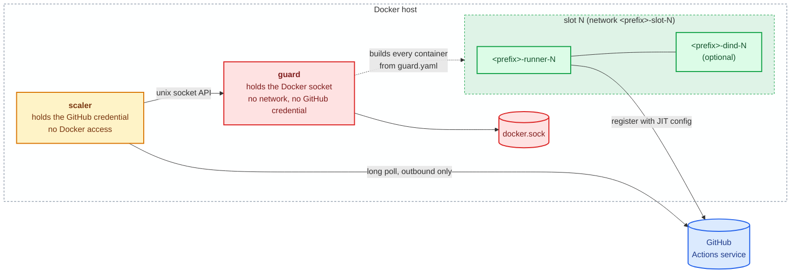
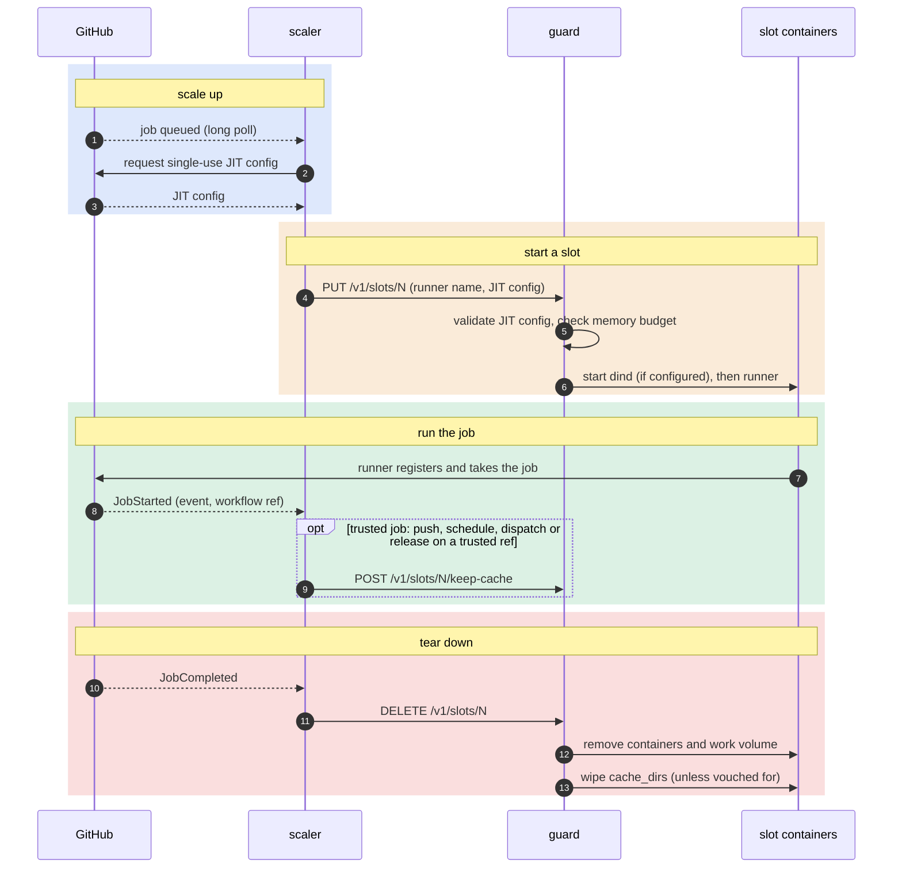
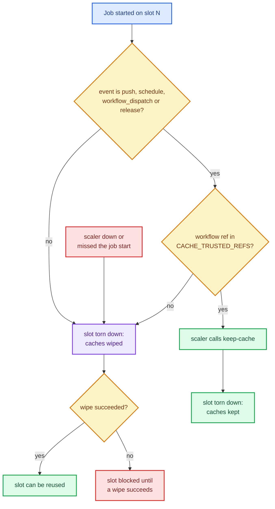

# runner-scaling

Ephemeral, autoscaled GitHub Actions runners on a single Docker host. There's no Kubernetes, and the part that
talks to the internet doesn't hold the Docker socket.

Each queued job gets a fresh runner (and, optionally, its own private Docker daemon), which takes that one job and
is thrown away. Nothing runs while nothing is queued. The scaler is built on GitHub's
[`actions/scaleset`](https://github.com/actions/scaleset) client, the same runner scale set API that
Actions Runner Controller uses. It long-polls GitHub (outbound only), so there's no webhook endpoint to expose.

> Status: early (0.x); see the [changelog](CHANGELOG.md). The scale set API and the `actions/scaleset` module are in public preview.

## How it works



The software has two parts, both in one small image (`runner-scaling guard` / `runner-scaling scaler`):

- **The scaler** registers a runner scale set, receives job messages, and asks GitHub for a single-use
  just-in-time (JIT) runner config whenever it needs a runner. It hands that config to the guard. It never
  touches Docker.
- **The guard** owns the Docker socket and exposes five calls to the scaler, on a unix socket:

  | Call | What it does |
  |---|---|
  | `GET /v1/info` | prefix, slot count, work dir, GitHub URL |
  | `GET /v1/slots` | which slots exist and their state |
  | `PUT /v1/slots/{n}` | `{runner_name, jit_config}`: start slot *n* |
  | `DELETE /v1/slots/{n}` | stop slot *n* |
  | `POST /v1/slots/{n}/keep-cache` | `{runner_name}`: the job on slot *n* is trusted, so keep its caches (see [Caches](#caches)) |

  Image, mounts, capabilities, limits, networks, `privileged`: every detail of the containers comes from
  `guard.yaml`, a file the scaler can't change. The guard has no network. It also reaps slots whose runner has
  exited, so slots never leak even if the scaler dies.

### Life of a job



## Threat model

The question this design answers: **what does someone who takes over the scaler get?** The scaler is the part
exposed to the internet: it parses GitHub's messages and holds the GitHub credential.

They can:
- start up to `max_slots` runners built exactly from your templates, and stop them;
- register runners in your scale set (they hold your GitHub credential, which this tool can't protect).

They can't:
- create containers of their own design, mount host paths, pick images or turn on `privileged`. The API
  has no way to express any of that;
- point a runner at a server of their own, or at a GitHub org of their own. The guard checks every JIT config
  (see below);
- reach the Docker API in any other way. Every request outside the five calls above is refused and logged as `DENY`.

**What the guard checks in a JIT config.** A JIT config isn't signed, and a runner trusts whatever servers it
names. The guard decodes it and requires that:
- `.runner`'s `ServerUrl` sits under your org's pinned **tenant URL**
  (`https://pipelines….actions.githubusercontent.com/<tenant>/`);
- every URL anywhere in the config is https and either under that tenant or on a shared host (the Actions broker,
  which only accepts runners holding a token your tenant issued);
- `AgentName` is the runner name requested for that slot, and `WorkFolder` is the guard's work dir;
- the config stays under 64 KiB.

**Not solved by this tool. Know these before you use it:**
- **The guard itself is root-equivalent**, because it holds the Docker socket. It is kept small: no network, no
  credentials, a fixed five-call API, read-only filesystem, all capabilities dropped.
- **With the dind sidecar, any job is root on the host.** The sidecar is privileged, so a job can start a
  `--privileged` container against it and mount the host's disk. The guard's API limits what a taken-over *scaler*
  can ask for; it does not limit what a *job* can do. Anyone who can get a workflow onto a repo that uses these
  runners (a push to any branch, a bot such as Dependabot, a stolen token) can run code as root on the host, and so
  can anyone who holds the scaler's GitHub credential (they can create a repo and a workflow of their own). That is
  the cost of letting jobs run `docker build`. Drop the `dind:` section if your jobs don't need Docker, and use a
  Docker-less pool for everything else. To narrow it, run the sidecar under Sysbox (see
  [Running dind under Sysbox](#running-dind-under-sysbox)), which makes "privileged" harmless to the host's disks and
  devices. It narrows the most common route; it is not a guarantee, because jobs still share the host kernel.
- **Only run jobs from repos you trust.** On GitHub, limit the runner group to private repos, disable fork PR
  workflows (or require approval), keep bot PRs off the Docker pool, and fence the per-slot subnets with a host
  firewall so jobs reach only the internet. On plans without branch protection, any branch can change a workflow.
- **Caches carry over between jobs, unless you list them in `cache_dirs`.** Runners are thrown away, but per-slot
  cache directories (`binds`, including a dind `/var/lib/docker`) are not. A job that can write to them can plant
  code (a toolchain binary, a retagged image) that the next job on that slot runs, whatever repo it comes from.
  Directories listed in `cache_dirs` are emptied by the guard after every job except one the scaler vouches for
  (a push, schedule, dispatch or release on a trusted ref, `refs/heads/main` by default), so a PR or branch job can't
  leave anything behind for a `main` build. Jobs from different repos on `main` still share caches, and a reusable
  workflow's ref is the called workflow's, not the caller's. Unlisted cache binds are not protected.
- **Without dind, jobs are still root in their container** unless the runner image says otherwise, and containers
  share the host kernel: a kernel escape is root on the host. Add a stronger runtime (gVisor, Sysbox, user
  namespaces) if the jobs aren't fully trusted.
- **Jobs can read their runner's credentials.** A job runs as the same user as its runner, so it can read the
  runner's session credentials. This is true of every self-hosted runner. The JIT config is kept out of the job
  environment, but it is on the runner process's command line.
- **The tenant URL is pinned on first use.** Leave `tenant_url` empty on first start. The guard refuses the first
  config and logs the URL it named. Pin that URL only if you are sure the scaler that sent it is yours and talks to
  your org. Check this before anything untrusted could reach the scaler, so on a fresh setup.

## Setup

> **Image availability: private preview.** CI builds and attests `ghcr.io/macleodtech/runner-scaling` on every `v*`
> tag, but the package is not public yet, so `docker pull` fails for anyone outside the org. Build it yourself for now:
> `docker build -t runner-scaling:local .`, and use that tag wherever the examples name the ghcr image. The package will
> be made public once the project settles; digests and tags won't change when it is.

1. **Credentials for the scaler.** A GitHub App (recommended: `GITHUB_APP_CLIENT_ID`, `GITHUB_APP_INSTALLATION_ID`,
   `GITHUB_APP_PRIVATE_KEY` or `GITHUB_APP_PRIVATE_KEY_FILE`) with organization *Self-hosted runners: read and
   write*, or a classic PAT with `admin:org` (`GITHUB_TOKEN` or `GITHUB_TOKEN_FILE`). For a repo-level scale set, use
   repo *Administration: read and write*.
   To make the App: Organization settings > Developer settings > GitHub Apps > New GitHub App. Untick Webhook, grant
   only Organization permission *Self-hosted runners: Read and write*, and choose "Only on this account". Then
   *Generate a private key* (a `.pem`), and *Install App* on the organization. The Client ID is on the App's page; the
   installation ID is the number at the end of the installation's settings URL
   (`.../settings/installations/<id>`). The App can only manage runners: unlike the PAT it can't touch repos or
   members, and its tokens expire after an hour.
2. **`guard.yaml`.** Start from [examples/guard.yaml](examples/guard.yaml). Pin image digests.
3. **Compose.** See [examples/compose.yaml](examples/compose.yaml). Start it and watch the guard:
   `docker compose logs -f guard`.
4. **Pin the tenant.** The first runner request is refused with
   `DENY ... no tenant_url pinned: this config's ServerUrl is "https://…/<tenant>/"`. Check it, put it in
   `tenant_url`, and restart the guard.
5. **Fence the slot networks (recommended).** Give `subnet` a fixed range and run the [firewall](#firewall)
   sidecar, so jobs reach the internet but not your LAN or the host. Set `require_file` to its gate file, and the
   guard won't start a slot until the rules are in place.
6. **Target it from workflows** with the scale set's labels, for example `runs-on: [self-hosted, ci]`.
7. **Optional: a second pool without Docker.** See [Several pools](#operations) and
   [examples/guard-lite.yaml](examples/guard-lite.yaml).

### Firewall

A job can talk to anything its network can reach. With the default Docker bridge setup that includes your LAN, the
host's own services and the other slots. The fence closes that: runner networks reach the internet and nothing else.

[examples/firewall.sh](examples/firewall.sh) is a small sidecar that does it with `iptables` and is wired into
[examples/compose.yaml](examples/compose.yaml):

- **Rules.** A chain `GH_RUNNERS` is hooked into `DOCKER-USER` (traffic the runners send through the host) and
  `INPUT` (traffic aimed at the host itself). Traffic from the fenced range to private and link-local addresses
  (`10/8`, `172.16/12`, `192.168/16`, `169.254/16`, `100.64/10`) is dropped, and the rest goes through to Docker's
  normal handling. Replies to connections the host opened still work.
- **Range.** `FENCE_SRC` (default `172.30.0.0/16`) must contain every guard's `subnet`. This is why `subnet` has a
  fixed value: with `subnet` empty Docker picks ranges the fence can't know about.
- **Gate.** After the rules are in place the script creates a file (`/gate/firewall-ok`, on a tmpfs volume).
  Set `require_file` to it in every guard: no slot starts without it, so a reboot can't start an unfenced runner
  before the rules are back.
- **Upkeep.** Every 30 seconds it re-checks the rules and re-applies any that are missing. If it can't, it removes the
  gate, so no new slot starts. Runners that are already running stay unfenced until the rules return (up to 30
  seconds after something flushes them). The guard watches the gate file too: when it vanishes while the guard is
  running it logs one `GATE WITHDRAWN` error and counts `gate_withdrawn_total` (see Metrics), so you hear about the
  gap. It doesn't kill running jobs over it.
- **Limits.** It needs host networking, `NET_ADMIN`, and a Docker that uses `iptables` and the `DOCKER-USER` chain.
  Docker's nftables firewall backend has no such chain and isn't supported.

Check it from a runner: a job that runs `curl -m 5 http://<a LAN address>` should time out, and
`curl https://github.com` should work.

### Scaler flags (or environment)

| Flag | Env | Default | |
|---|---|---|---|
| `--name` | `SCALE_SET_NAME` | guard prefix | scale set name |
| `--labels` | `SCALE_SET_LABELS` | the name | comma-separated labels workflows target |
| `--runner-group` | `RUNNER_GROUP` | `default` | runner group |
| `--min-runners` | `MIN_RUNNERS` | 0 | runners kept warm |
| `--max-runners` | `MAX_RUNNERS` | guard `max_slots` | can't exceed `max_slots` |
| `--delete-scale-set` | | | delete the scale set and exit |
| `--socket` | `GUARD_SOCKET` | `/run/runner-scaling/guard.sock` | guard API socket |
| | `DASHBOARD_ADDR` | off | e.g. `127.0.0.1:8080`: serve the [dashboard](#dashboard) |
| | `DASHBOARD_PEERS` | none | `name=http://host:port,...`: fold other scalers (pools) into this dashboard; they must share the token |
| | `DASHBOARD_TOKEN[_FILE]` | none | if set, the dashboard requires it (bearer, `?token=`, or basic-auth password) |
| | `CACHE_TRUSTED_REFS` | `refs/heads/main` | refs whose push/schedule/dispatch/release jobs keep their caches; `none` wipes always |
| | `LOG_LEVEL` | `info` | `debug`, `info`, `warn` or `error` |

### Operations

- **Logs.** `docker logs <guard> 2>&1 | grep DENY` shows every refusal; the same events are counted in
  [metrics](#metrics). When the guard refuses a JIT config, it
  also logs the config's shape: keys and URL hosts only, never values.
- **Restarts.** Restarting the scaler or guard doesn't kill running jobs. The scale set stays registered, and
  queued jobs wait for it. If the old message session hasn't expired yet, the scaler retries until it has.
- **Remove everything.** Stop the scaler, then
  `docker rm -f $(docker ps -aq -f label=io.github.runner-scaling.instance=<prefix>)`.
  To remove the scale set from GitHub too: `runner-scaling scaler --delete-scale-set`.
- **Changing labels.** The scaler keeps the scale set's labels in step with `--labels`. GitHub accepts a label
  update on an existing scale set and ignores it, so when the labels change the scaler deletes the scale set and
  creates it again (with a new id). Runners already started for the old one finish their jobs. Renaming `--name` creates a second scale set and leaves the first behind: remove it with
  `--delete-scale-set`.
- **Several pools.** Run one guard + scaler pair per kind of runner, each with its own `prefix`, subnets, API
  socket and labels: for example one with a `dind:` section for jobs that build images, and a lighter one without
  for everything else ([examples/guard-lite.yaml](examples/guard-lite.yaml) and
  [examples/compose.yaml](examples/compose.yaml) show both). Without dind, `work_bind` directories are emptied by a one-shot container (runner image,
  no network, no other mounts).
- **One memory budget for all runners.** Set `memory_budget` (e.g. `8G`) and `memory_reserve` (default `1G`, the
  assumed minimum size of one slot) in every pool's guard config, with the same values. The guard measures the working
  set of every runner-scaling container on the host (all pools, found by label) through the Docker API. It starts a
  new slot only if measured use, counting each slot as at least the reserve, plus the reserve fits the budget;
  otherwise the scaler is told to retry on its next poll. A slot counts as its measured use but at least the reserve,
  and for `memory_ramp` (default 2m) after its containers were created, at least `memory_ramp_share` (default half)
  of their memory limits: a job that has just started looks light and then grows, so a burst of new jobs isn't
  admitted against memory they haven't used yet, while settled light jobs pack tightly. If measured use stays over the budget for three checks in a
  row, the guard removes its newest runner. This is enforced in the guard, so it needs no host or systemd setup, but it
  is a polling limit: a sudden spike can briefly overshoot, so keep the per-container `memory` limits as the hard
  stop. The guard rejects a config where one slot's `memory` limits add up to more than the budget (that slot could never
  finish) and prints a notice at startup when all slots together may exceed it, which is normal for a shared budget.
  Concurrent starts on one guard are serialised, and a slot whose containers exist but are not running yet counts as
  the reserve, so two guards starting slots at the same moment can only both be admitted in the few milliseconds before
  the first container exists; the backstop covers that. Set `cpu_shares` (Docker's default weight is 1024) to make runners yield CPU to other workloads when the host
  is busy. If you'd rather have the kernel enforce one limit, `cgroup_parent` (e.g. `runner-scaling.slice`) puts all
  runners under one cgroup that you can cap with `systemctl set-property`.

### Keeping the runner image current

The scale set is registered with `DisableUpdate: true`: a runner never updates itself, so the version inside your
pinned runner image is the version you run. GitHub refuses runners that get too old, and when that happens jobs just
wait. Check from time to time (or from cron):

```
scripts/check-runner-image.sh guard.yaml guard-lite.yaml   # exits 1 when behind
```

To bump: pick a newer tag of your runner image, `docker pull` it, put its digest in every guard config's runner
`image`, run `runner-scaling guard --check`, then restart the guards (running jobs keep their containers).

### Metrics

With the [dashboard](#dashboard) on (`DASHBOARD_ADDR`), the scaler also serves `GET /metrics` in Prometheus text
format. It sits behind the same token (use `Authorization: Bearer <token>`) and carries a `pool` label, so scrape each
pool's scaler. History isn't kept by the scaler: Prometheus (or anything that reads the format) does that.

```yaml
scrape_configs:
  - job_name: runner-scaling
    authorization: {type: Bearer, credentials_file: /etc/prometheus/runner_scaling_token}   # the dashboard token
    static_configs:
      - targets: ["scaler:8080", "scaler-lite:8080"]   # one per pool; Prometheus on the scalers' Docker network
```

| Metric | Type | Meaning |
|---|---|---|
| `runner_scaling_jobs{state}` | gauge | jobs queued and running, as the scaler knows them |
| `runner_scaling_scale_set{stat}` | gauge | GitHub's own scale set counters (available, acquired, assigned, running, busy and idle runners) |
| `runner_scaling_slots{state}` | gauge | slots by runner state (`running`, `starting`, `exited`, ...) |
| `runner_scaling_max_slots` | gauge | the guard's `max_slots` |
| `runner_scaling_memory_used_bytes` | gauge | working set of this pool's runners |
| `runner_scaling_memory_budget_bytes` | gauge | `memory_budget` (shared by every pool on the host) |
| `runner_scaling_slot_memory_bytes{slot}` | gauge | working set per slot |
| `runner_scaling_job_start_latency_seconds` | histogram | from a job being queued to a runner starting it |
| `runner_scaling_job_duration_seconds` | histogram | how long jobs ran |
| `runner_scaling_slot_start_seconds` | histogram | time to bring one slot up |
| `runner_scaling_slot_starts_total{outcome}` | counter | slot starts, `ok` or `error` |
| `runner_scaling_jobs_completed_total{result}` | counter | finished jobs by result |
| `runner_scaling_guard_up` | gauge | 1 if the guard answered |
| `runner_scaling_guard_*_total` | counters | the guard's own counters, below |

The guard counts what it does, since it started, and the scaler re-exports it (the guard has no network, so it can't
serve metrics itself; its read-only `GET /v1/counters` is what the scaler reads):

| Counter | Meaning |
|---|---|
| `denied_total` | a bad or refused request, or an unknown endpoint: the guard's API was misused. **Alert on any.** |
| `not_ready_total` | a start refused with 503: the memory budget was full, or the firewall gate was missing |
| `admission_refused_total` | starts held back by the memory budget (normal under load; a steady climb with idle memory means the reserve or ramp is too cautious) |
| `gate_withdrawn_total` | `require_file` vanished (the firewall rules were lost): running slots may be unfenced until it returns. **Alert on any.** |
| `conflicts_total` | a start or stop refused because the slot was in use or in transition |
| `starts_total`, `start_failures_total` | slots started, and starts that failed after being admitted |
| `reaped_runner_exited_total`, `reaped_max_runtime_total`, `reaped_memory_budget_total` | slots torn down, by reason. `memory_budget` means the backstop killed a running job. |

Alerts worth having:

```yaml
- alert: RunnerScalingGuardDenied   # the guard's API was misused: look at the guard's DENY log lines
  expr: increase(runner_scaling_guard_denied_total[10m]) > 0
- alert: RunnerScalingFirewallGateLost   # the fence is down; running jobs may be unfenced
  expr: increase(runner_scaling_guard_gate_withdrawn_total[10m]) > 0
- alert: RunnerScalingJobKilledForMemory   # the memory backstop removed a running job
  expr: increase(runner_scaling_guard_reaped_memory_budget_total[1h]) > 0
- alert: RunnerScalingGuardDown
  expr: runner_scaling_guard_up == 0
  for: 2m
- alert: RunnerScalingJobsWaiting   # jobs queued while no slot is free and memory isn't the reason: check start errors
  expr: runner_scaling_jobs{state="queued"} > 0 and runner_scaling_slots{state="running"} == 0
  for: 10m
- alert: RunnerScalingNearBudget
  expr: sum(runner_scaling_memory_used_bytes) > 0.9 * max(runner_scaling_memory_budget_bytes)
  for: 10m
```

### Slow a job down instead of killing it (`memory_high`)

`memory` is a hard limit: a container that passes it is OOM-killed, and so is its job. Set `memory_high` below it
(for example `memory: 3G`, `memory_high: 2560M`) and a container that passes `memory_high` is slowed by the kernel's
memory reclaim instead, which usually lets a short spike pass. It is the cgroup v2 `memory.high` setting. It is optional and
off unless you set it on `runner` or `dind`.

Docker has no setting for it (the Engine API ignores cgroup v2 `Unified` values), so the guard writes it after the
container has started, from a one-shot container: no network, all capabilities dropped but two, and the host's
`/sys/fs/cgroup` mounted read-write for that one write. The guard container itself gets no cgroup access. The one-shot
finds each container's cgroup by its id, wherever `cgroup_parent` puts it. This needs cgroup v2 and a runner image
with `sh` and `find`. It is best effort: if the write fails, the guard logs `memory_high not applied` and the job runs
with the hard limit alone.

How it behaves: a container that grows past `memory_high` is held there, and the kernel pushes the excess to swap
and throttles the allocating process. Tested with a 512M hard limit and a 256M `memory_high`: use stayed at about 256M,
the rest went to swap, and nothing was killed until the swap allowance (by default as large as `memory`) ran out. That
means the throttle needs swap on the host to work: with none, the excess is all that reclaim has to work with and the
container ends up in the same place as without it. Pick a value that leaves headroom: a job held at `memory_high` runs
slowly rather than failing, so a job that really needs more will crawl until it hits the hard limit or `max_runtime`.

### Dashboard

Set `DASHBOARD_ADDR` and the scaler serves a read-only status page, a bit like the Actions tab: the runner slots and
their state, running jobs with elapsed time, queued jobs with wait time, and the last 100 finished jobs (repo,
workflow, event, branch, result, duration). It refreshes every few seconds from `/api/state` (JSON).

- Running several pools? Give each scaler a dashboard and list the others in `DASHBOARD_PEERS` on the one you open:
  its page then shows every pool, tagged by name. Peers need the same token and a network path between the scalers.
- It is read-only (GET only) and has no controls. History lives in memory, so a scaler restart empties it.
- Job names and repos can be sensitive for private repos. Bind it to loopback or a private network, and put a reverse
  proxy with TLS in front if it leaves the host. `DASHBOARD_TOKEN` adds a shared-secret check but sends it in clear
  without TLS.
- In a container, listen on `0.0.0.0:8080` and publish the port on loopback only (`ports: ["127.0.0.1:8080:8080"]`).
  `/healthz` is always open.

### Caches

Bind per-slot cache directories (`{slot}` in a path is replaced with the slot number) so warm jobs skip downloads.
A dind `/var/lib/docker` must never be shared between slots. Slots are only ever reused one runner at a time.

A job can plant code in a cache that the next job on that slot runs, so list the same directories under
`cache_dirs`. The guard then empties them in a one-shot container (no network) when a slot is torn down, at startup,
and before reusing a slot whose wipe failed, unless the scaler vouched for the job:



`CACHE_TRUSTED_REFS` is comma-separated and defaults to `refs/heads/main`; `none` wipes after every job. A missing
vouch always means a wipe, so a failure costs speed, not safety. The cost is cold caches for every PR and branch job.

### guard.yaml reference

[examples/guard.yaml](examples/guard.yaml) shows the common fields. All of them:

| Field | Meaning |
|---|---|
| `github_url` | org or repo URL the scale set is registered at |
| `tenant_url` | pinned Actions tenant URL; leave empty on first start |
| `shared_hosts` | extra hosts allowed in a JIT config with any path (default: the Actions broker) |
| `prefix` | names everything the guard creates; 1-31 lowercase letters, digits, dashes |
| `max_slots` | most runners at once (1-250) |
| `subnet` | per-slot network such as `172.30.{slot}.0/24`; empty lets Docker pick |
| `work_dir` | job workspace path inside the runner (and dind); not under `/tmp` with dind |
| `work_bind` | host directory (`{slot}` required) to use as `work_dir` instead of a Docker volume |
| `cache_dirs` | host directories (`{slot}` required) emptied after untrusted jobs |
| `memory_budget`, `memory_reserve` | host-wide memory cap and per-slot admission estimate |
| `memory_ramp`, `memory_ramp_share` | how long a new slot counts at a share of its memory limits (default `2m`, `0.5`; `0s` turns the ramp off) |
| `cgroup_parent` | put all runner containers under one cgroup you can cap with systemd |
| `require_file` | the guard starts no slot until this file exists (a gate for a host firewall) |
| `start_timeout` | how long a slot may take to come up (default 2m) |
| `max_runtime` | the reaper removes a runner that runs longer than this (default: no limit) |
| `reap_interval` | how often exited runners are cleaned up (default 5s) |
| `runner`, `dind` | container templates: `image`, `user`, `command`, `env`, `binds`, `privileged`, `runtime`, `cap_drop`, `cap_add`, `security_opt`, `dns`, `memory`, `memory_high`, `cpus`, `cpu_shares`, `pids`, `healthcheck`, `log_opts`, `labels`, and for dind `prune_on_stop` |

Omit `dind` for runners without a private Docker daemon.

## Running dind under Sysbox

[Sysbox](https://github.com/nestybox/sysbox) is an OCI runtime that runs the dind sidecar without `privileged`. Root
inside it maps to an unprivileged host uid, so a job that starts a `--privileged` container against that dind gets a
container that cannot see the host's disks or devices. `examples/guard-sysbox.yaml` is `guard.yaml` with
`runtime: sysbox-runc` in place of `privileged: true`; run it as a pool of its own (own `prefix`, own subnets) so you
can move repos over one at a time.

Install Sysbox on the host first and register it with Docker (`runtimes` in `daemon.json`). Things that bit us on
Ubuntu 24.04 with Docker 29:

- The Sysbox installer refuses to run while containers exist unless `bip` and `default-address-pools` are set in
  `daemon.json`. Set them to Docker's own defaults first.
- sysbox-fs needs an AppArmor override for `fusermount3` that allows `/var/lib/sysboxfs/**/`.
- Sysbox adds host services (`sysbox-mgr`, `sysbox-fs`) that Docker now depends on for these containers. Keep them
  in mind when you upgrade the kernel or Docker.

What we measured on a real build and a probe suite (private repo, quiet host, runner state on local NVMe):

- A real BuildKit image build took the same time as with privileged dind (388 s against 383 s).
- Three Sysbox slots and one privileged slot ran at the same time. The inner privileged container had uid map
  `0 165536 65536` (privileged dind: `0 0 4294967295`, real host root), 16 `/dev` entries against 218, and no host
  block devices against 14. `/proc/sys`, `/proc/uptime` and `/proc/swaps` are served by sysbox-fs.
- The per-slot firewall fence behaved the same, from the runner and from inside inner containers, and no slot could
  reach another slot's dind.
- Compose, published ports, a mounted `docker.sock`, `--network host`, `NET_ADMIN`, ptrace, `chown` on bind mounts,
  overlay mounts and memory limits all worked as under privileged dind. No job changed the host's sysctls, `/dev`,
  accounts, cron or sudoers.

What it does not do:

- Containers still share the host kernel. A kernel exploit is still an escape, and we did not try to escape.
- A job can still make the host kernel load a module: a container with `NET_ADMIN` creating a dummy interface loaded
  `dummy`. That holds with or without Sysbox. Blacklist modules you don't want loadable on a host that runs
  untrusted jobs.
- It only changes the dind sidecar. The runner container, the guard and the firewall are as before.
- Only a few kinds of workflow were tried. Jobs that need KVM, kernel modules or `/proc/sys` writes may not work.
- Start and stop took no longer on a quiet host. Under heavy load on a slow disk we saw slow starts and a container
  that would not stop; keep runner state on a fast local disk.

## The `runners` CLI

`runners` is a small read-only command for asking a running deployment what it is doing. It talks only to the
scaler's dashboard (`/api/state` and `/metrics`), so it needs the dashboard URL and token and nothing else: no Docker
socket, no GitHub credential. It shows every pool the dashboard folds in (the `DASHBOARD_PEERS` ones too).

```sh
go install github.com/MacLeodTech/runner-scaling/cmd/runners@latest   # or: go build -o runners ./cmd/runners

export RUNNERS_URL=http://localhost:8787            # default
export RUNNERS_TOKEN_FILE=/path/to/dashboard_token  # or RUNNERS_TOKEN; sent as a bearer header, never in the URL

runners            # status: slots in use, queued and running jobs, per pool
runners slots      # every slot with memory, CPU and process count
runners jobs -n 20 # queued, running and the 20 most recent jobs
runners memory     # memory used against memory_budget, per slot
runners watch -i 2 # status, refreshed every 2 seconds
runners status --json   # status, slots, jobs and memory also have --json
```

## Development

```
go test -race ./...
docker build -t runner-scaling:dev .
```

This repository's CI always runs on GitHub-hosted runners. It builds the image that will hold a Docker socket,
so it must not build on a runner that image controls.

## License

Apache-2.0. See [LICENSE](LICENSE). Copyright 2026 MacLeodTech.